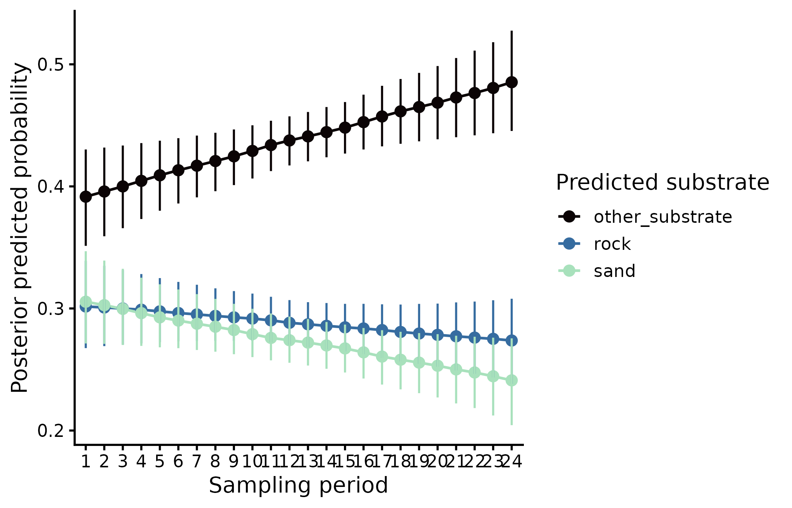
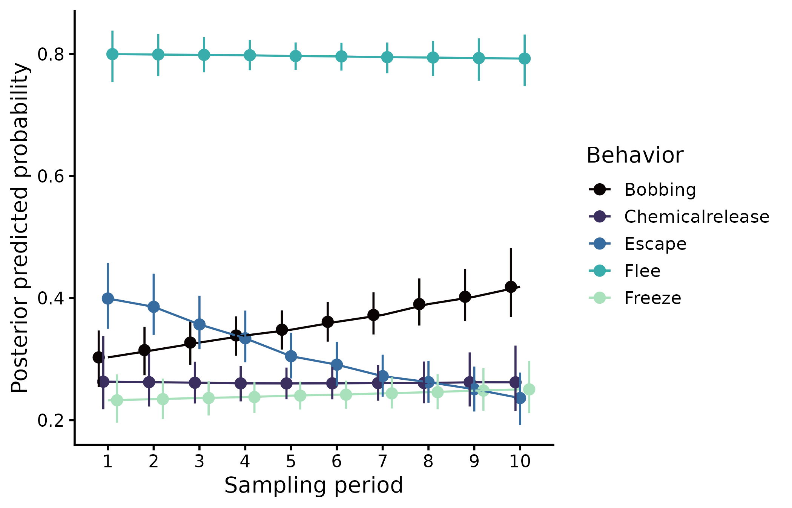

This site contains the analyses behind the manuscript (in preparation). We exposed field-collected *Prionostemma* sp. 1 harvestmen (Opiliones) with different leg conditions to a brief aversive stimulus paired with one substrate (rock or sand) and a rewarding stimulus (food) on the other. We then modeled their substrate use and their defensive responses (flee, escape, bobbing, chemical release and freeze) with Bayesian mixed models fitted in [brms](https://paul-buerkner.github.io/brms/). Candidate models were compared with approximate leave-one-out cross-validation, and effects were estimated as posterior contrasts in predicted probabilities with [marginaleffects](https://marginaleffects.com/).

## Analysis report

- **[Statistical analysis](scripts/stats_v02.qmd)**: data preparation, candidate models, model selection and posterior contrasts for substrate use and defensive behavior (Figs. 2–5)
- **[Supplementary tables](output/supplementary_tables.pdf)** (PDF): model selection results and posterior estimates (Supplementary Tables 1–6)

## Main results

::: {.figure-gallery}

:::

## Reproducibility

All code and data are available in the [GitHub repository](https://github.com/maRce10/feeding-behavior-covariates-harvestmen). See the repository README for the folder structure and for the model fits, which are too large to be hosted on GitHub.
